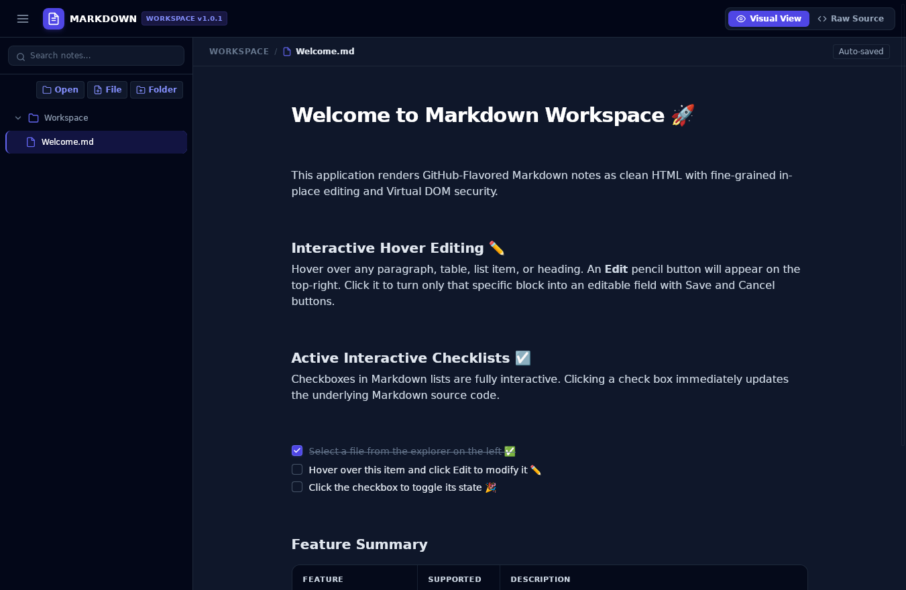

# Markdown Workspace

"The Markdown editor I've always wanted." - me

Every Markdown editor I've tried is just a mess. Too many features. Too many functions. Too must this. Too much that. Doesn't run on Linux. Runs on Linux but only as a Node app. Etc. Etc. I just wanted something to Do The Thing and nothing more. So, Gemini and I built it. And this is it.

Dead simple interface. Dead simple editing. No bells. No frills. Barely anything to get between you and your Markdown. I gave it two editing modes:

* **Visual View** that shows you what your rendered Markdown looks like while letting you edit on an object-by-object basis. Really targeted editing to fine tune a document.
* **Raw Source** for when you need to edit a whole document at one time.

It recognizes :octocat: GitHub-flavored Markdown. For reference, see:
* [GitHub-Flavored Markdown Spec](https://github.github.com/gfm/)
* [Basic writing and formatting syntax](https://docs.github.com/en/get-started/writing-on-github/getting-started-with-writing-and-formatting-on-github/basic-writing-and-formatting-syntax)
* [A cheat sheet](https://gist.github.com/Myndex/5140d6fe98519bb15c503c490e713233)

It does have a Read-only mode for when you don't want to risk accidentially editing them. It also has a light & dark theme (or System so it does what the rest of your desktop does.) The bottom status bar shows some line/word/character counts, in case you like tracking that sort of thing.

There is no AI built into it (there are plenty of AI-enabled editors out there to choose from.)

#### Note:
The file list ignores the following directories:
  - `.git`
  - `node_modules`
  - `dist`
  - `build`
  - `.next`
  - `.cache`
  - `.gemini`

### Configuration

There is a config file in your home directory called `.markdown-workspace.json` that holds 2 settings:

* The "read-only" flag. Set to either true or false.
* The "app-theme" flag. Set to either light, dark, or system.

-----

Built using Google Antigravity/Gemini 3.8 Flash and whiskey :tumbler_glass: